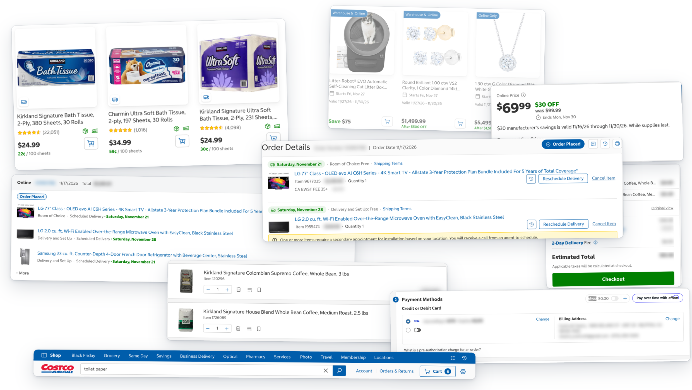

# Costco, Cleaned Up

This userscript makes costco.com denser and easier to scan. Every page gets a two-row header, search results fit more products with a price per unit, and the cart gets shorter.

<sub>1. Install a userscript extension for your browser</sub>

<table><tr><th><sub>Chrome</sub></th><th><sub>Firefox</sub></th><th><sub>Edge</sub></th><th><sub>Safari</sub></th></tr><tr>
<td><a href="https://chromewebstore.google.com/detail/violentmonkey/jinjaccalgkegednnccohejagnlnfdag"></a> <a href="https://chromewebstore.google.com/detail/tampermonkey/dhdgffkkebhmkfjojejmpbldmpobfkfo"></a> <a href="https://chromewebstore.google.com/detail/scriptcat/ndcooeababalnlpkfedmmbbbgkljhpjf"></a></td>
<td><a href="https://addons.mozilla.org/firefox/addon/violentmonkey/"></a> <a href="https://addons.mozilla.org/firefox/addon/tampermonkey/"></a> <a href="https://addons.mozilla.org/firefox/addon/scriptcat/"></a></td>
<td><a href="https://microsoftedge.microsoft.com/addons/detail/violentmonkey/eeagobfjdenkkddmbclomhiblgggliao"></a> <a href="https://microsoftedge.microsoft.com/addons/detail/tampermonkey/iikmkjmpaadaobahmlepeloendndfphd"></a> <a href="https://microsoftedge.microsoft.com/addons/detail/scriptcat/liilgpjgabokdklappibcjfablkpcekh"></a></td>
<td><a href="https://apps.apple.com/app/userscripts/id1463298887"></a> <a href="https://apps.apple.com/app/tampermonkey/id6738342400"></a></td>
</tr></table>

<sub>2. Then install the userscript</sub>

[](https://raw.githubusercontent.com/sushruth/costco-mod/main/costco-cart.user.js)

<sub>What it looks like</sub>

[](SCREENSHOTS.md)

[Before and after, page by page](SCREENSHOTS.md). The screenshots blur the warehouse, ZIP code and the cart's prices and discounts.

## Install

1. Install a userscript extension for your browser from the table at the top.
2. Click **Install userscript** under it.

The script is tested with Violentmonkey. To turn parts on or off, use the gear next to the cart.

## Privacy

The script sends requests only to costco.com. It keeps what it learns in your browser. At install, your userscript manager downloads the [Phosphor](https://phosphoricons.com/) icon font from unpkg.com one time.

## Development

```
bun install
bun run dev
```

CLAUDE.md has the architecture and workflow.

## License

MIT
