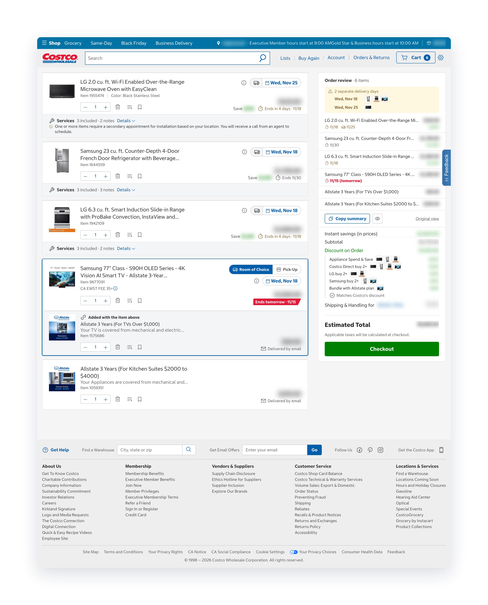

# Costco, Cleaned Up

This userscript makes costco.com denser and easier to scan. Every page gets a two-row header, and the cart gets shorter.

[](https://raw.githubusercontent.com/sushruth/costco-mod/main/costco-cart.user.js)

| Before | After |
| --- | --- |
|  |  |

The screenshots blur prices, discounts, ZIP code and warehouse.

## Install

1. Install a userscript manager: [Violentmonkey](https://violentmonkey.github.io/), [Tampermonkey](https://www.tampermonkey.net/), [ScriptCat](https://docs.scriptcat.org/) or [Userscripts](https://apps.apple.com/app/userscripts/id1463298887) for Safari.
2. Click **Install** above.

The script is tested with Violentmonkey. To turn parts on or off, use the gear next to the cart.

## Privacy

The script sends requests only to costco.com. It keeps what it learns in your browser. At install, your userscript manager downloads the [Phosphor](https://phosphoricons.com/) icon font from unpkg.com one time.

## Development

```
bun install
bun run dev
```

CLAUDE.md has the architecture and workflow.

## License

MIT
