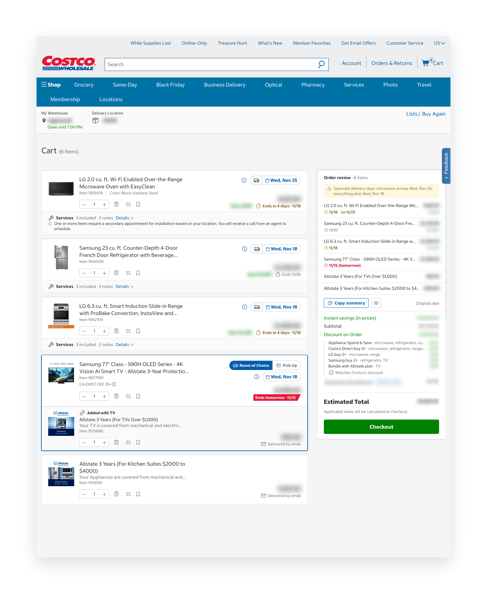

# Costco Cart, Cleaned Up

Costco's cart page is long and hides what matters: when each promo ends, which days things arrive, and where the "Discount on Order" comes from. This userscript restyles the cart in place so those answers sit next to each item.

[](https://raw.githubusercontent.com/sushruth/costco-mod/main/costco-cart.user.js)

| Before | After |
| --- | --- |
|  |  |

Prices, ZIP code and warehouse are blurred in both screenshots.

## Install

1. Install a userscript manager: [Violentmonkey](https://violentmonkey.github.io/), [Tampermonkey](https://www.tampermonkey.net/), [ScriptCat](https://docs.scriptcat.org/) or [Userscripts](https://apps.apple.com/app/userscripts/id1463298887) for Safari.
2. Click **Install** above, or open this link, and confirm:

```
https://raw.githubusercontent.com/sushruth/costco-mod/main/costco-cart.user.js
```

The manager checks that URL for updates. Tested with Violentmonkey in a Firefox-based browser; the other managers read the same `.user.js` format.

## What changes

- Each item is a compact card: title, item number, quantity stepper and icon buttons for remove, add to list and save for later.
- The price sits bottom-right with the savings and the promo end date. Promos ending within a day get a red badge.
- Delivery shows as one chip with the date; items with several options (delivery, pick-up and others) get a toggle that drives Costco's own radio buttons.
- A protection plan that Costco auto-added with an item (like the Allstate plan with a TV) is drawn as one unit with that item.
- The order panel lists every item with its promo end date, warns when items arrive on different days, and copies a plain-text summary.
- **Discount on Order** is broken down by promo (multi-buy, spend-tier and bundle offers), with the items each one covers, and checked against Costco's total.
- **Original view** in the panel switches back to Costco's page at any time.

## Privacy

Everything stays in your browser. The script talks only to costco.com, with the same requests a product page makes when you open it, and stores what it learns (promo tiers, with a capture date and expiry) in your userscript manager's storage. No analytics, no third-party servers.

The one outside request is made by your userscript manager at install time: it downloads the [Phosphor](https://phosphoricons.com/) icon font from unpkg, once.

## Development

- `bun dev/preview.ts [saved-cart.html]` builds `cart.preview.html` from a cart page you saved with your browser, with Costco's scripts removed and this script injected.
- For a live dev install, serve the folder (`python3 -m http.server 8723`), open `http://127.0.0.1:8723/costco-cart.user.js`, tick **Track external edits** in Violentmonkey and keep that tab open.
- `localStorage.setItem('cm-dev', '1')` in the cart tab adds a **Redlines** button that outlines every element by nesting depth.

Saved cart pages contain your personal data and are git-ignored.

## License

MIT
