# Before and after

Costco's own pages are on the left, and the same pages with the userscript are on the right. Each pair was taken at 1440px wide, except the phone pair at 390px. The warehouse, ZIP code, name, address, card, membership and order numbers, and prices and discounts are blurred.

## Home

| Before | After |
| --- | --- |
|  |  |

## Phone header

The header becomes one blue row of icon links, with the search and Shop menu under it.

| Before | After |
| --- | --- |
|  | 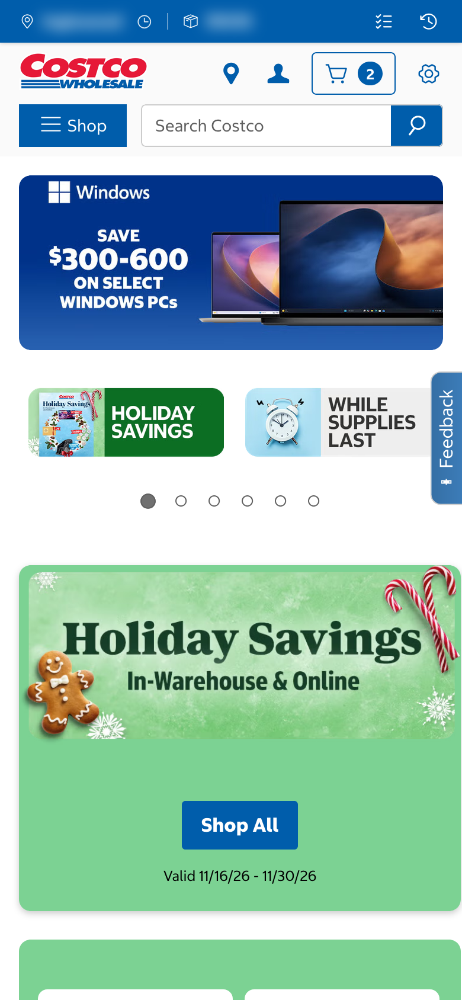 |

## Search

| Before | After |
| --- | --- |
|  |  |

## Category

The Shop by Category grid fits on one screen.

| Before | After |
| --- | --- |
|  |  |

## Savings

Deal cards look like the search tiles: the channel as a pill on the photo, a 2-line title, the dates under it, then the price with Buy Online as a cart icon. Deals that haven't started yet fade back and show their start date.

| Before | After |
| --- | --- |
| 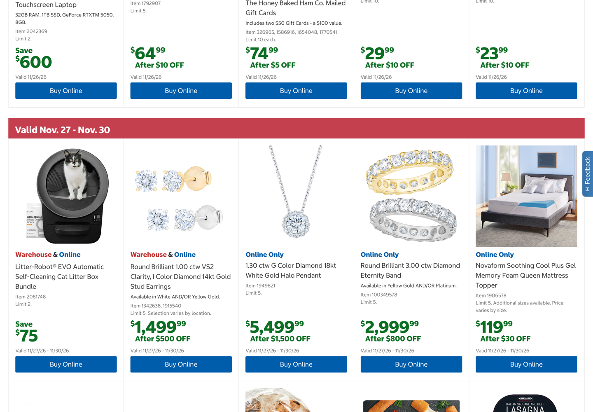 | 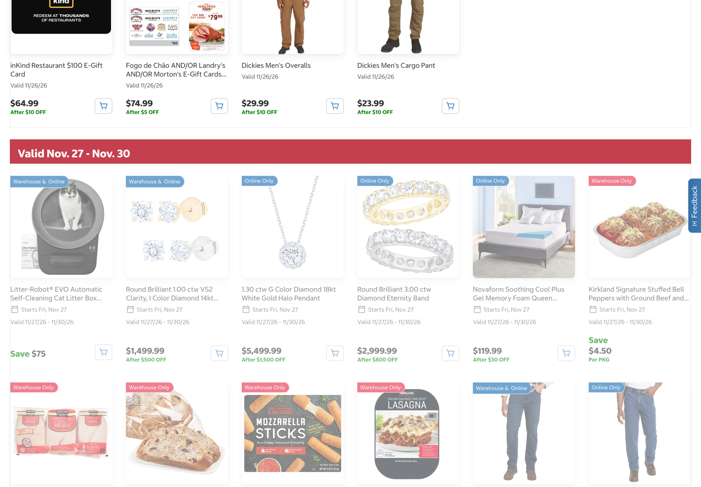 |

## Product

The promo's end date sits under the price, and the repeated "$30 OFF" line is gone.

| Before | After |
| --- | --- |
|  |  |

## Warehouse locator

Each warehouse shows today's hours, the Executive member start time and the gas price on one line.

| Before | After |
| --- | --- |
| 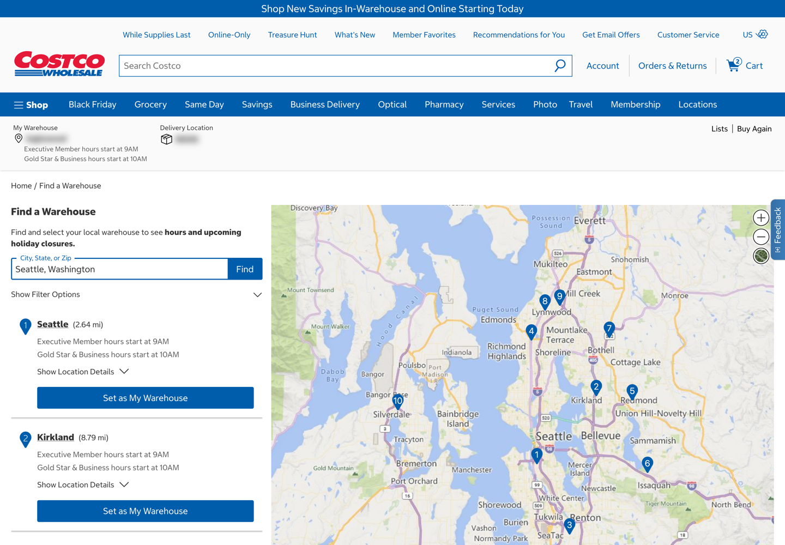 |  |

## Cart

| Before | After |
| --- | --- |
|  | 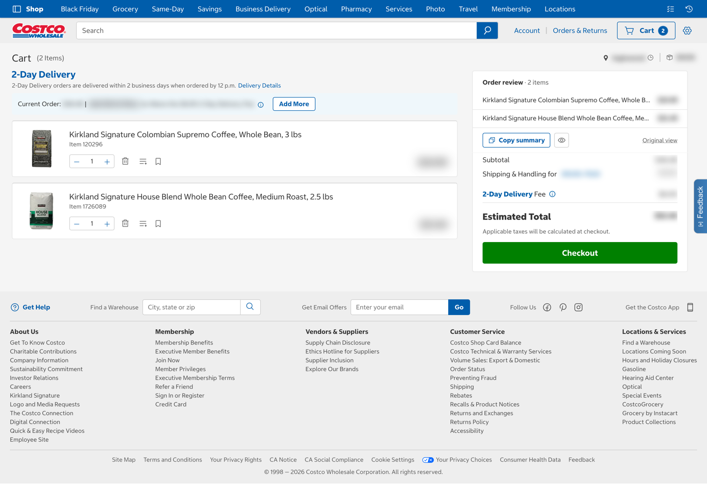 |

## Orders

Each order is a light card with a one-line head: number, date and total, then View Order and Buy Again as an icon. The status is a pill, and each item takes one row with its delivery on one small line.

| Before | After |
| --- | --- |
| 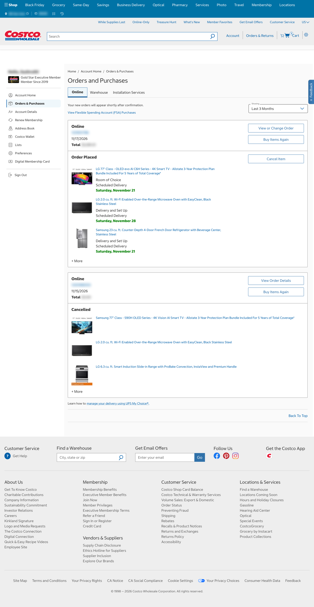 | 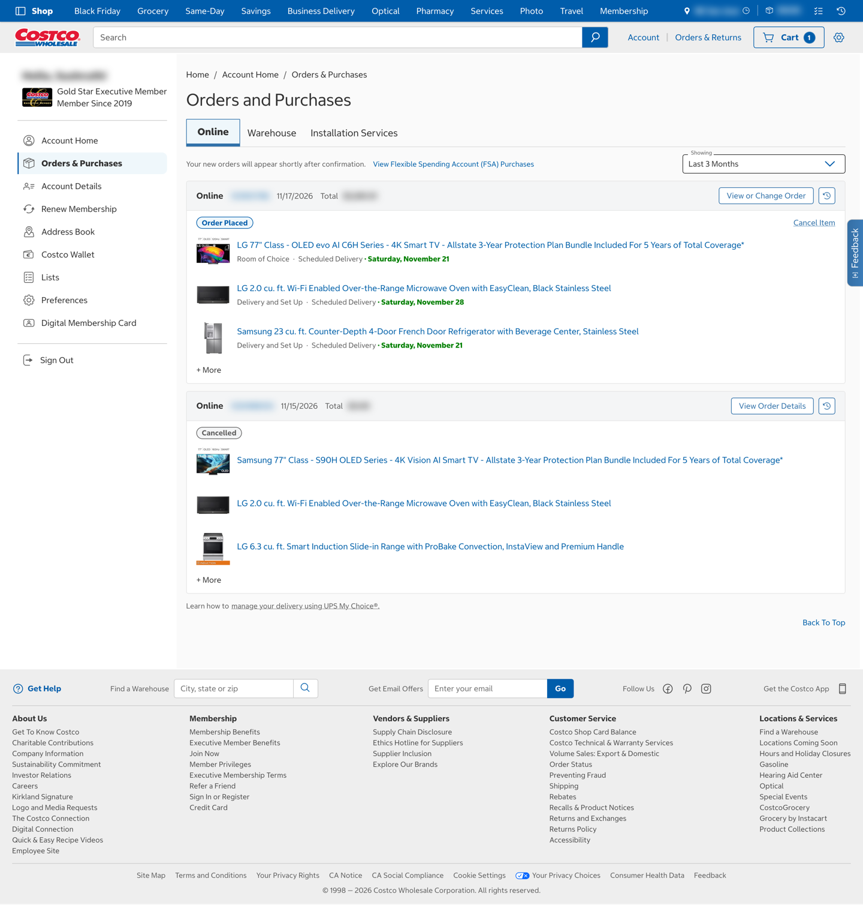 |

## Order details

The title row carries the order status as a chip, with Order Summary, Buy Again and Print as icons. Each delivery opens with a date chip, and each item fits one row with its actions beside the price. Only the services' second-appointment notice stays.

| Before | After |
| --- | --- |
| 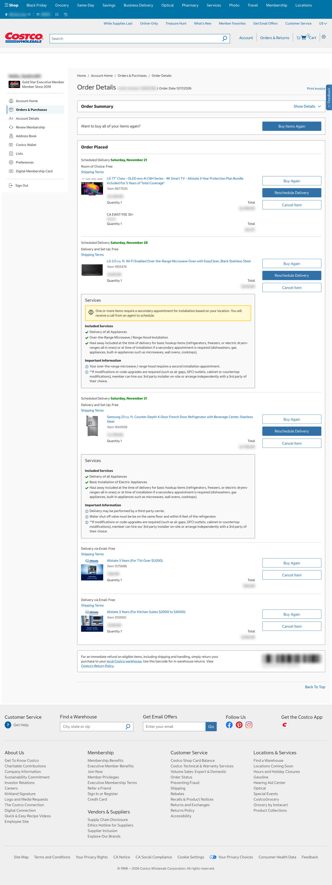 | 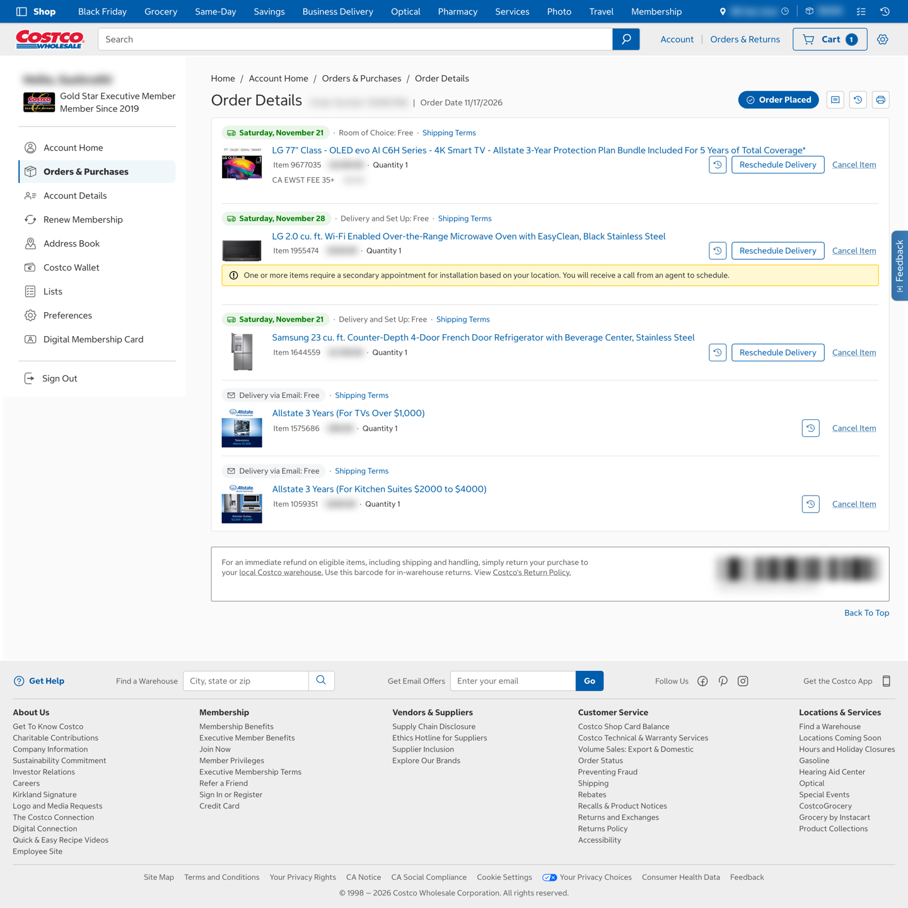 |

## Checkout

The Shop Card wallet is a chip beside a small Affirm button, the saved card fits one line, and the billing address sits beside it.

| Before | After |
| --- | --- |
| 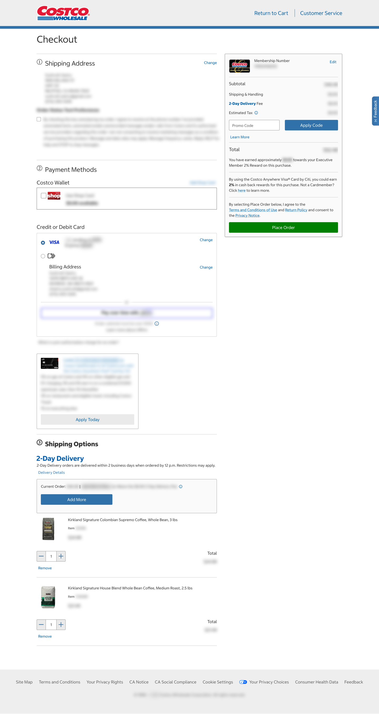 | 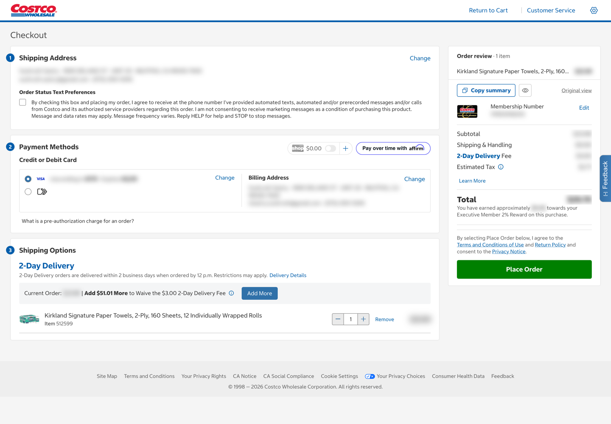 |

[Back to the README](README.md)
