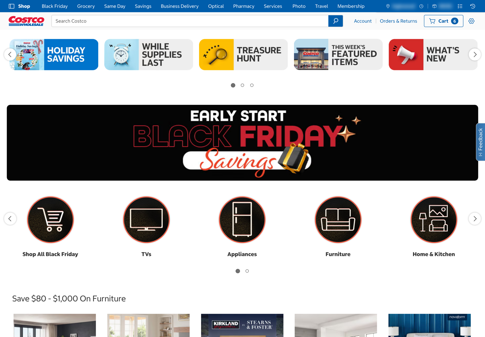
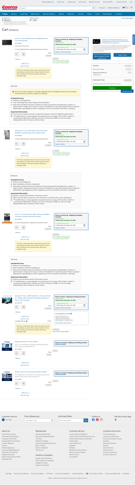

# Before and after

Costco's own pages are on the left, and the same pages with the userscript are on the right. Each pair was taken at 1440px wide. Home and search show the top of the page, and the cart shows the whole page. The warehouse, ZIP code and the cart's prices and discounts are blurred.

## Home

| Before | After |
| --- | --- |
|  |  |

## Search

| Before | After |
| --- | --- |
|  |  |

## Cart

| Before | After |
| --- | --- |
|  |  |

[Back to the README](README.md)
