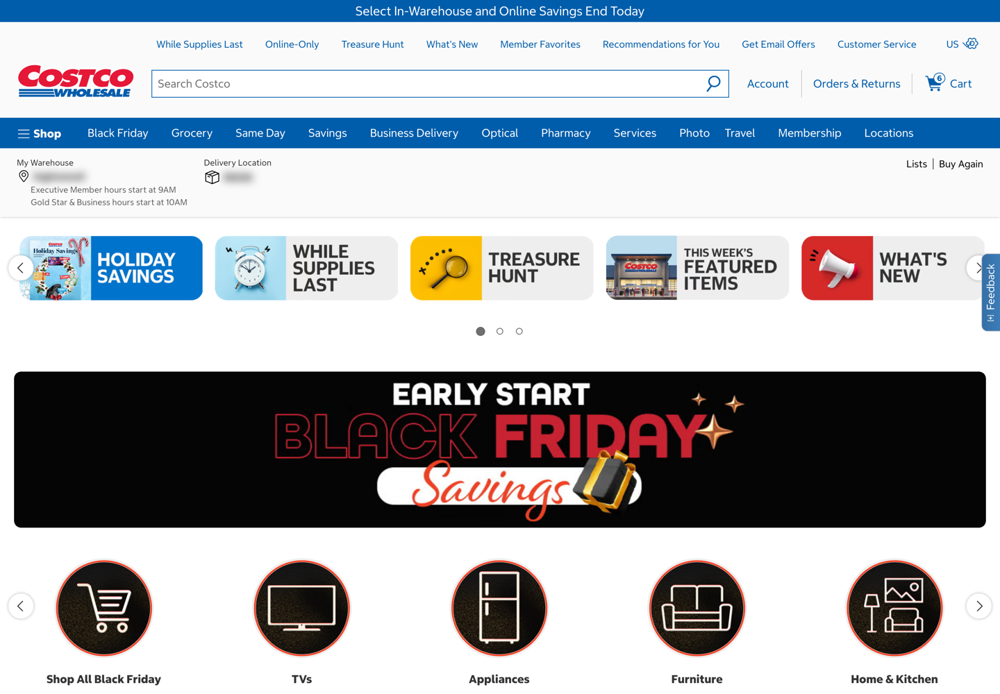
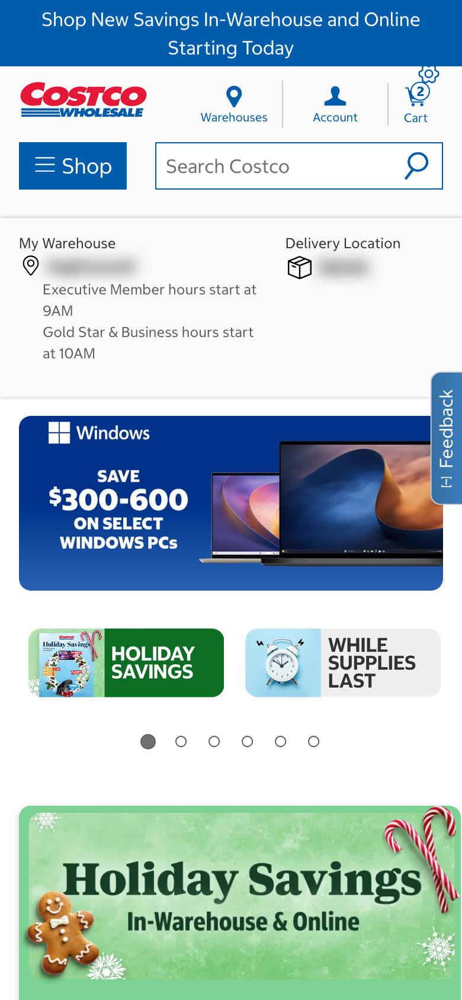
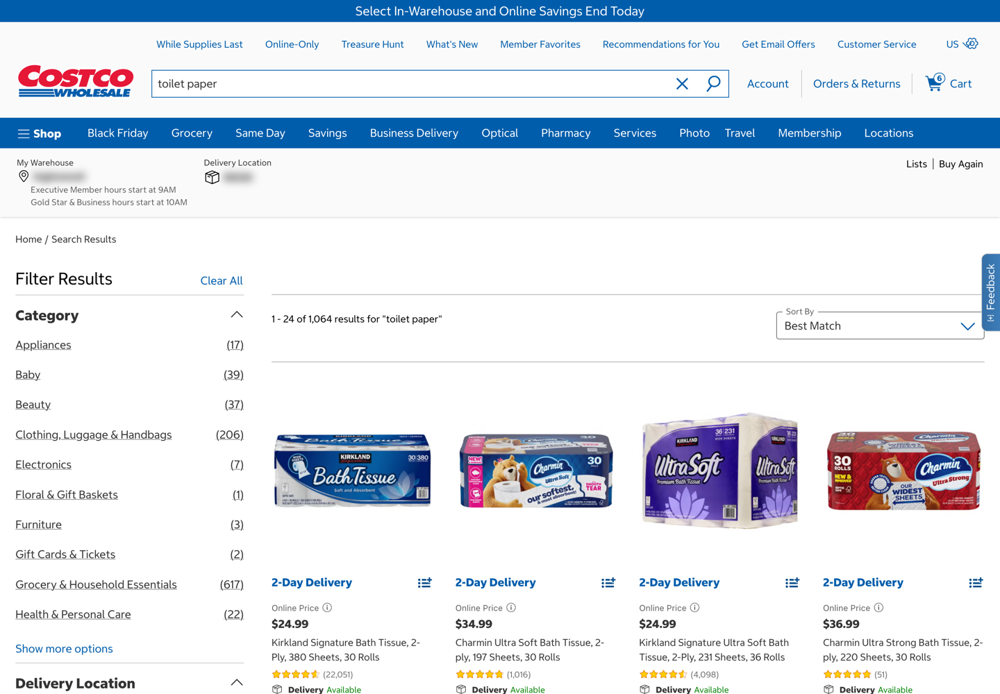
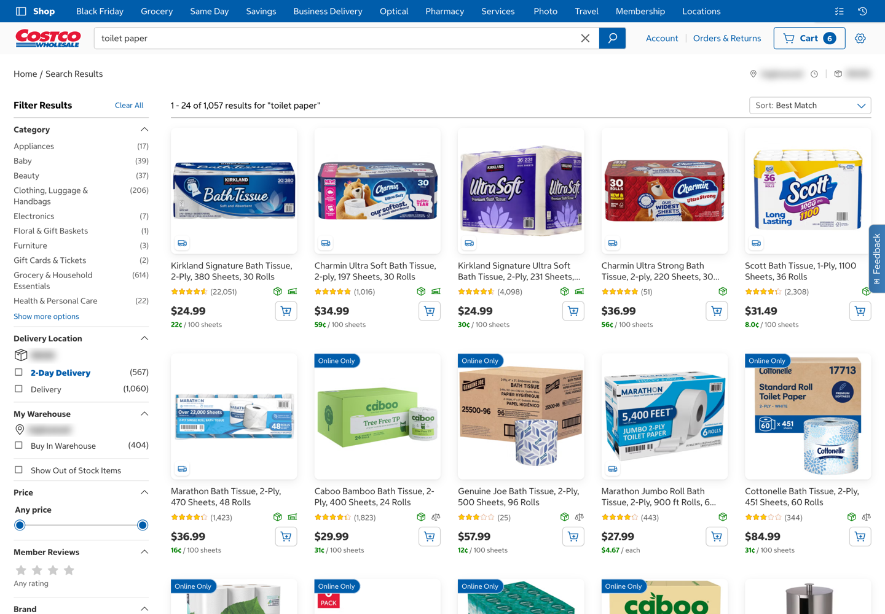
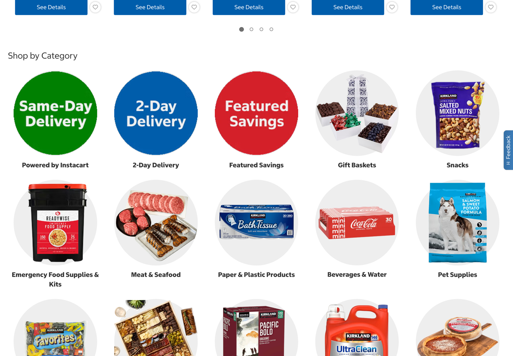
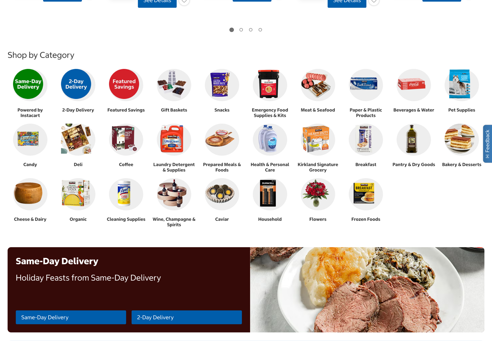
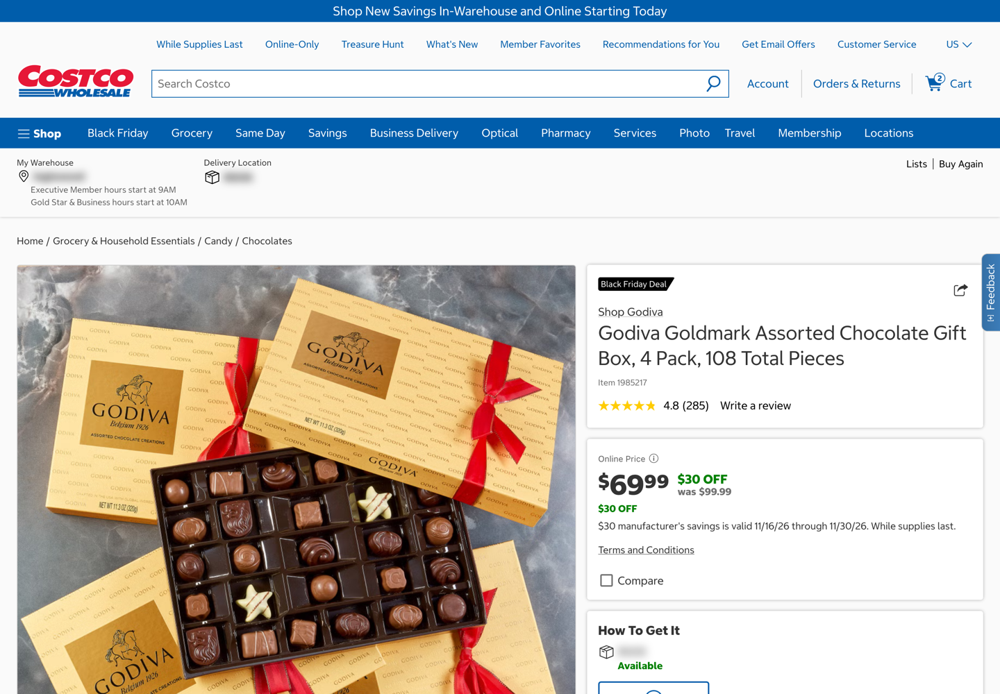
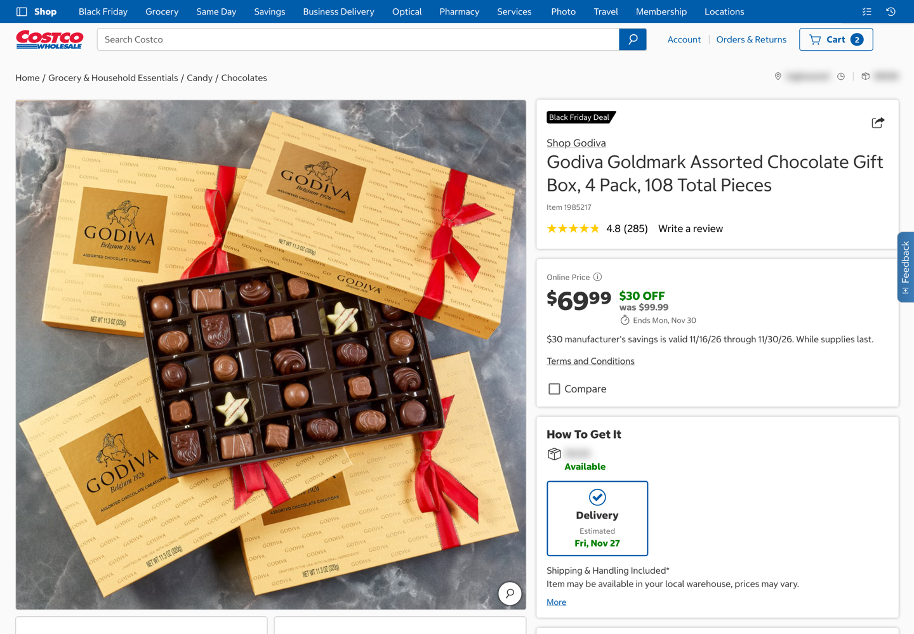
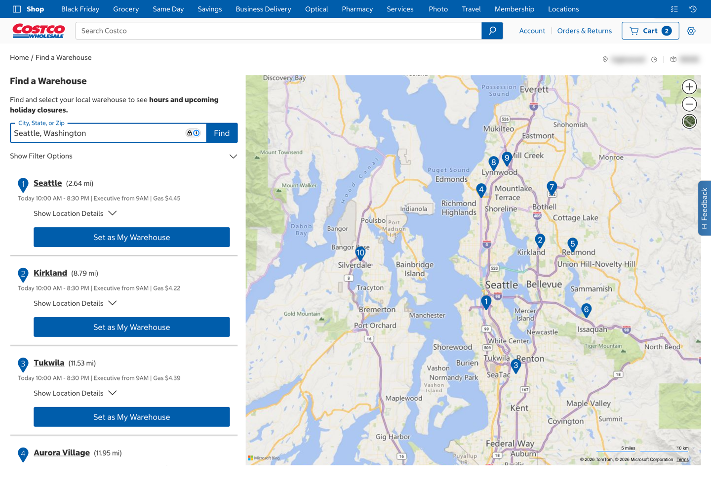

# Before and after

Costco's own pages are on the left, and the same pages with the userscript are on the right. Each pair was taken at 1440px wide, except the phone pair at 390px. The warehouse, ZIP code, address, card, membership number and the cart's prices and discounts are blurred.

## Home

| Before | After |
| --- | --- |
|  |  |

## Phone header

The header becomes one blue row of icon links, with the search and Shop menu under it.

| Before | After |
| --- | --- |
|  |  |

## Search

| Before | After |
| --- | --- |
|  |  |

## Category

The Shop by Category grid fits on one screen.

| Before | After |
| --- | --- |
|  |  |

## Savings

Deals that haven't started yet fade back and show their start date, and Buy Online buttons are outlined.

| Before | After |
| --- | --- |
|  |  |

## Product

The promo's end date sits under the price, and the repeated "$30 OFF" line is gone.

| Before | After |
| --- | --- |
|  |  |

## Warehouse locator

Each warehouse shows today's hours, the Executive member start time and the gas price on one line.

| Before | After |
| --- | --- |
|  |  |

## Cart

| Before | After |
| --- | --- |
|  |  |

## Checkout

| Before | After |
| --- | --- |
|  |  |

[Back to the README](README.md)
